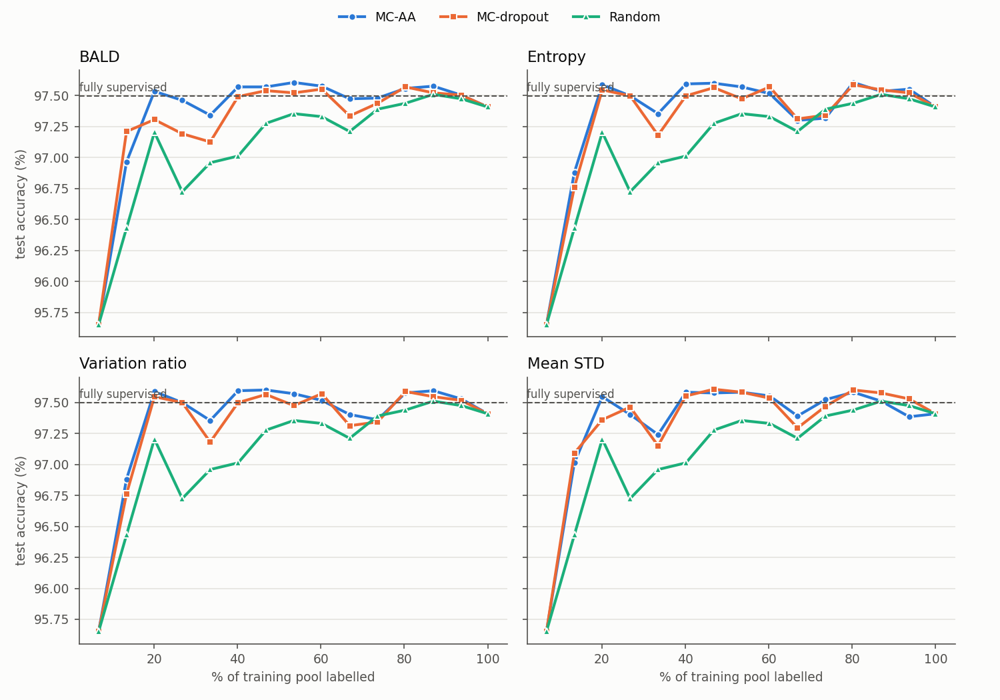
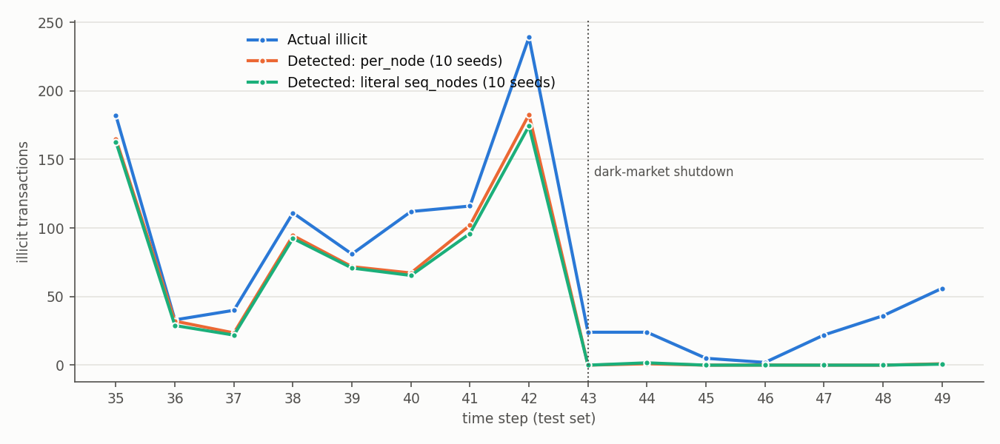

# Temporal-GCN for anti-money laundering on Elliptic (reproduction)

Re-implementation of

> I. Alarab, S. Prakoonwit. *Graph-Based LSTM for Anti-money Laundering: Experimenting Temporal Graph
> Convolutional Network with Bitcoin Data.* Neural Processing Letters 55, 689–707 (2023).
> [doi:10.1007/s11063-022-10904-8](https://doi.org/10.1007/s11063-022-10904-8)

There's no official code, so everything here is written from the paper.

**Task:** classify Bitcoin transactions as illicit or licit. Elliptic has ~200k transactions (nodes) linked by
payment flows (edges), split into 49 time steps. The models train on steps 1–34 and are tested on 35–49, using the
93 local features.

**Model:** LSTM → TAGConv → TAGConv (K=3, hidden 50, dropout 0.7), applied to each time-step graph.

**Second half of the paper:** active learning. Uncertainty comes from MC-dropout or MC-AA (adversarial
perturbations). It is scored with BALD, entropy, variation ratio or mean std, and compared to random labelling.

## Results

### Table 1: test set, illicit class. 10 seeds here; the paper reports a single run

| | Accuracy | Precision | Recall | F1 |
|---|---|---|---|---|
| Paper | 97.7 | 92.7 | 71.3 | 80.6 |
| Ours, per-node LSTM | 97.50 ± 0.08 | 90.9 ± 2.2 | 68.4 ± 0.8 | **78.0 ± 0.4** |
| Ours, literal LSTM | 96.95 ± 0.13 | 83.7 ± 2.8 | 66.0 ± 1.4 | 73.8 ± 0.8 |

The two rows differ in how the LSTM is applied, which the paper doesn't pin down.
- **Literal reading** (`--lstm_mode seq_nodes`): the paper uses PyTorch 1.11. There, `nn.LSTM` on a 2-D node
  matrix runs over all nodes of a time step as one long sequence, in file order.
- **Per-node reading** (`--lstm_mode per_node`): each node is its own length-1 sequence.

The per-node version gets much closer to the paper and is ~50× faster, so the ablation and active-learning runs use
it.

The other variations tried were weight decay, undirected edges, class weights, and the recipe from the authors'
earlier GCN paper. Weight decay and undirected edges help a little on their own (+0.9 / +0.3 F1). Combined with the
per-node reading, all of them lower F1 (`results/sweep*/summary.md`). Feeding softmax output straight into NLLLoss,
another literal reading, collapses to predicting everything licit.

### Table 4: layer ablation, accuracy %, 5 seeds

| Model | Layers | Ours | Paper |
|---|---|---|---|
| model0 | LSTM / TAG / TAG | 97.50 ± 0.12 | 97.77 |
| model1 | Lin / TAG / TAG | 97.28 ± 0.17 | 97.66 |
| model2 | LSTM / Lin / TAG | 97.36 ± 0.31 | 97.76 |
| model3 | LSTM / TAG / Lin | 97.57 ± 0.08 | 97.57 |
| model4 | LSTM / Lin / Lin | 97.54 ± 0.07 | 97.44 |
| model5 | Lin / Lin / Lin | 97.50 ± 0.01 | 97.51 |
| model6 | LSTM / TAG | 97.36 ± 0.12 | 97.63 |
| model7 | TAG / TAG | 95.91 ± 0.25 | 96.65 |

### Table 5: number of hops K

97.58 / 97.55 / 97.50 for K = 1 / 2 / 3. Paper: 97.75 / 97.71 / 97.77.

### Active learning (Fig. 4, Tables 2–3)

The pool is all labelled training nodes. Each round labels 2,000 more. The table gives the share of the pool needed
to reach the fully supervised accuracy (97.50%).

| | BALD | Entropy | Var. ratio | Mean std |
|---|---|---|---|---|
| MC-AA | 20% | 20% | 20% | 20% |
| MC-dropout | 47% | 20% | 20% | 40% |
| Random | 87% | | | |

Every uncertainty arm beats random. The Wilcoxon test on the paired curves gives p ≤ 0.003 for all 8 arms; the
paper found 4 of 8 significant.



Fig. 3 shows illicit transactions per test step. As in Weber et al. 2019, detection falls to about zero after the
dark-market shutdown at t = 43:



### Summary

**Reproduces:**
- the overall performance level (within ~2.6 F1, using the per-node reading);
- removing the LSTM hurts the most;
- active learning reaches full accuracy with ~20% of the labels.

**Doesn't reproduce:**
- "the full model is best": simpler variants, including a plain MLP, tie it;
- "3 hops is best": 1, 2 and 3 hops are within noise of each other.

**One inconsistency in the paper:** with two classes, entropy and variation ratio (1 − max p) are both monotone in
max p. So they rank nodes the same way and should pick the same batches. Our curves for the two match up to
float ties, yet the paper reports quite different numbers for them.

## Running it

Everything runs on CPU. The scripts in `scripts/` are SLURM jobs, but they also run with plain `bash`. Run them from
the repo root.

```bash
bash scripts/setup_env.sh           # conda env "aml_tgcn": torch 1.11.0 + PyG 2.0.4
sbatch scripts/prep_data.sh         # downloads Elliptic (PyG mirror), writes data/processed/
sbatch scripts/table1.sh            # literal LSTM, 10 seeds (~35 min each)
sbatch scripts/sweep.sh             # one-change-at-a-time variants
sbatch scripts/sweep2.sh            # per-node LSTM, 10 seeds, plus a determinism check
sbatch scripts/ablation.sh          # Tables 4-5
sbatch scripts/active_learning.sh   # Fig. 4 / Tables 2-3, 9 arms
sbatch scripts/summarize.sh         # tables + figures
```

Single runs, for example:

```bash
python run_supervised.py --out results/test --lstm_mode per_node --seed 0
python run_active_learning.py --out results/al_test --method mc_aa --acquisition bald --lstm_mode per_node
```

Runs are bitwise reproducible given the same hardware, software stack and thread count. Every run logs sha256
fingerprints of the initial model, the final model and the predictions. `compare_runs.py` checks two runs against
each other, and `scripts/det_check.sh` exercises every code path twice.

## Layout

```
tgcn/            data loading, model, training, MC-dropout / MC-AA, determinism helpers
run_*.py         supervised and active-learning entry points
summarize_*.py   tables and figures from results/
scripts/         env setup + job scripts
results/         per-run metrics / configs and the summary tables (weights and predictions not included)
```

The data is not included. `prep_data.py` downloads it from the PyG mirror of the
[Elliptic dataset](https://www.kaggle.com/datasets/ellipticco/elliptic-data-set).
